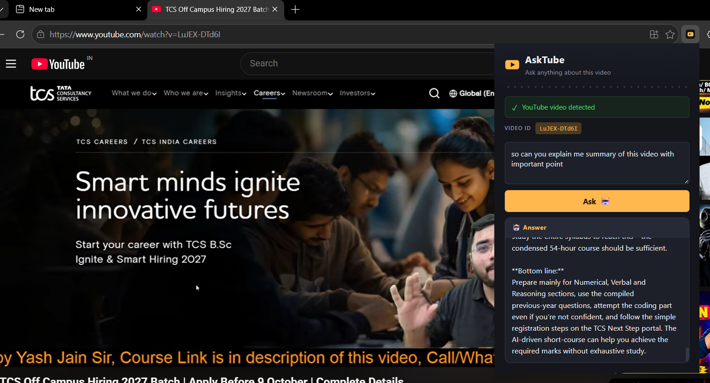

# AskTube

AskTube is a Chrome extension + FastAPI backend that lets you ask questions
about the YouTube video you're currently watching. It answers using a RAG
(Retrieval-Augmented Generation) pipeline built on the video's own transcript
— so answers stay grounded in what's actually said in the video.

```
User opens YouTube → plays a video → clicks AskTube → asks a question
   → extension sends video_id + question → FastAPI backend
   → transcript + RAG → Groq LLM → answer displayed in the popup
```

## Project structure

```
AskTube/
├── extension/          Chrome extension (Manifest V3)
│   ├── manifest.json
│   ├── popup.html
│   ├── popup.css
│   ├── popup.js
│   └── icons/
│
├── backend/             FastAPI + RAG pipeline
│   ├── app.py            FastAPI routes
│   ├── transcript.py      YouTube transcript fetching + error handling
│   ├── vectorstore.py     FAISS creation/loading, keyed by video ID
│   ├── rag_chain.py       Retriever + prompt + Groq LLM
│   ├── requirements.txt
│   └── .env.example
│
├──screenshots/
│   ├── result.png
├── .gitignore
└── README.md
```

## How it works

1. The extension detects the active tab's YouTube video and extracts its
   video ID (`extractVideoId()` in `popup.js`, handles `youtube.com/watch?v=`,
   `youtu.be/`, and `/shorts/` URLs).
2. You type a question and hit **Ask** (or Enter — use Shift+Enter for a new
   line).
3. The extension `POST`s `{ video_id, question }` to the backend's `/ask`
   endpoint. **The Groq API key never leaves the backend.**
4. The backend checks whether that video already has a saved FAISS index
   under `backend/vectorstores/<video_id>/`.
   - If yes, it loads it directly.
   - If no, it fetches the transcript, splits it into chunks
     (`RecursiveCharacterTextSplitter`), embeds the chunks with a
     HuggingFace embedding model, and saves a new FAISS index — so this
     work only happens once per video, not once per question.
5. The most relevant chunks are retrieved and passed, along with your
   question, into a prompt that instructs the Groq LLM to answer **only**
   from that context (and to say so plainly if the answer isn't in the
   transcript).
6. The answer is returned as JSON and rendered in the popup.

## Quick start

Two things need to run: the **backend** (a local server, keeps running in
its own terminal) and the **extension** (loaded once into your browser).
Do them in this order.

### Step 1 — Set up the backend

**Requirements:** Python 3.10+ (3.12 confirmed working)

```bash
cd backend
python3 -m venv venv
```

Activate the virtual environment:

```bash
# macOS / Linux
source venv/bin/activate

# Windows (Command Prompt or PowerShell)
venv\Scripts\activate
```

You should see `(venv)` at the start of your terminal prompt once it's active.

> **Windows users:** if you already have `torch` installed elsewhere, pip
> will reuse it automatically in this venv only if it's installed *inside*
> this venv too. On a fresh venv, plain `pip install torch` pulls in several
> GB of unused NVIDIA CUDA packages even without a GPU. To avoid that,
> install the CPU-only build first:
> ```bash
> pip install torch --index-url https://download.pytorch.org/whl/cpu
> ```
> Then continue with the step below as normal. This has no effect on
> functionality — AskTube's embedding step doesn't need a GPU.

Install dependencies:

```bash
pip install -r requirements.txt
```

### Step 2 — Add your Groq API key

```bash
cp .env.example .env       # Windows: copy .env.example .env
```

Open `.env` in a text editor and set:

```env
GROQ_API_KEY=your_groq_api_key_here
```

Get a free key at https://console.groq.com.

### Step 3 — Start the backend

Still inside `backend/`, with the venv active:

```bash
uvicorn app:app --reload --port 8000
```

Leave this terminal window open — it needs to keep running the whole time
you use AskTube. Verify it's up by visiting `http://localhost:8000/health`
in a browser, or:

```bash
curl http://localhost:8000/health
```

You should see `{"status":"ok"}`.

### Step 4 — Load the extension

AskTube is a Manifest V3 extension, so it works unmodified in **Chrome,
Microsoft Edge, and Brave** (all Chromium-based) — only the settings page
URL differs:

| Browser | Extensions page |
|---|---|
| Chrome | `chrome://extensions` |
| Edge | `edge://extensions` |
| Brave | `brave://extensions` |

1. Open that page for your browser.
2. Turn on **Developer mode** (a toggle — top-right in Chrome/Brave, left
   sidebar in Edge).
3. Click **Load unpacked**.
4. Select the `AskTube/extension` folder — the one *containing*
   `manifest.json`, not the file itself, and not the top-level `AskTube`
   folder.
5. An "AskTube" card should appear with no errors. Pin it via the
   puzzle-piece icon in the toolbar for quick access.

### Step 5 — Use it

1. Open any YouTube video (a `/watch?v=...` URL — not the homepage).
2. Click the AskTube icon. You should see **✓ YouTube video detected**.
3. Type a question and press Enter (or click **Ask 🤖**).
4. The first question on a given video takes longer (5–15s) while the
   backend builds that video's transcript index. After that it's fast.
 
<p align="center">
   
</p>

### API reference

**`POST /ask`**

Request:
```json
{
  "video_id": "J5_-l7WIO_w",
  "question": "What is the main topic of this video?"
}
```

Response:
```json
{
  "answer": "The video explains..."
}
```

If the transcript can't be retrieved (disabled, unavailable, wrong
language, etc.), the backend returns a `422` with a friendly
`{"detail": "..."}` message instead of a stack trace.

The extension talks to `http://localhost:8000` by default (see
`BACKEND_URL` at the top of `popup.js`) — make sure the backend is running
before you use it. If you deploy the backend elsewhere, update that
constant and the `host_permissions` entry in `manifest.json` to match.

If the video has no transcript available, or transcripts are disabled for
it, you'll see a clear message explaining why instead of a generic error.

## Notes on transcripts

The backend tries transcripts in the languages listed in `TRANSCRIPT_LANGUAGES`
in your `.env` (defaults to `en,hi` — English, then Hindi), falling back to
any available transcript (translated if possible) before giving up. It
gracefully handles every failure case `youtube-transcript-api` can raise:

- No transcript available / requested language unavailable
- Transcripts disabled by the uploader
- Video unavailable, unplayable, or age-restricted
- Invalid video ID
- YouTube temporarily blocking/rate-limiting requests
- Malformed data returned by YouTube
- Transient network errors

Every failure is logged in full server-side (`logger.exception(...)` in
`transcript.py`) before being converted into a friendly `{"detail": "..."}`
message for the extension — so the real cause is always visible in the
backend terminal, even though the user only sees a clean message.

`youtube-transcript-api` scrapes an undocumented part of YouTube's site, so
it can occasionally break or get rate-limited when YouTube changes something
on their end — this is a known limitation of the library itself, not a bug
in AskTube. If you hit persistent "blocked" errors, check the
[project's GitHub](https://github.com/jdepoix/youtube-transcript-api) for
known issues, or wait and retry from the same network.

## Troubleshooting

**"Something went wrong while contacting YouTube"** — check the backend
terminal for a full traceback logged just above the warning line. The
exception type tells you the real cause (e.g. `RequestBlocked`,
`TranscriptsDisabled`, `YouTubeDataUnparsable`).

**Popup shows "⚠ Please open a YouTube video first"** — you need to be on
an actual `/watch?v=...`, `/shorts/...`, or `youtu.be/...` URL, not the
YouTube homepage or a channel page.

**Nothing happens when you click Ask** — confirm the backend is still
running (`uvicorn` should be live in its terminal) and that
`http://localhost:8000/health` responds. If you changed the backend port,
update `BACKEND_URL` in `popup.js` and `host_permissions` in
`manifest.json` to match.

**Extension changes aren't showing up** — after editing any extension
file, go to your browser's extensions page and click the refresh icon on
the AskTube card to reload it.

**`pip install` runs out of disk space** — `sentence-transformers` pulls in
`torch`, which on Linux/Windows defaults to a multi-GB CUDA build even
without a GPU. See the CPU-only install note in Step 1 above.

## Security notes

- The Groq API key lives only in `backend/.env` and is never sent to, or
  referenced by, any extension code.
- `backend/.env` is listed in `.gitignore` — never commit your real key.
- CORS is wide open (`allow_origins=["*"]`) for local development, since
  Chrome extensions call the backend from a `chrome-extension://<id>`
  origin. **Before shipping to production**, restrict this to your
  extension's exact origin in `app.py`.
